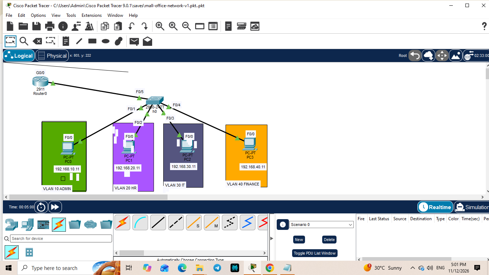
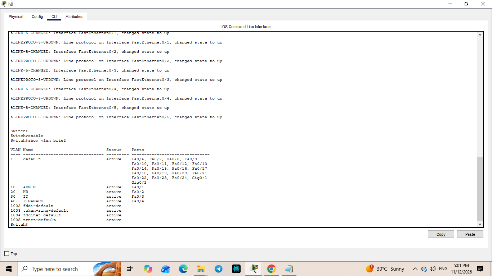
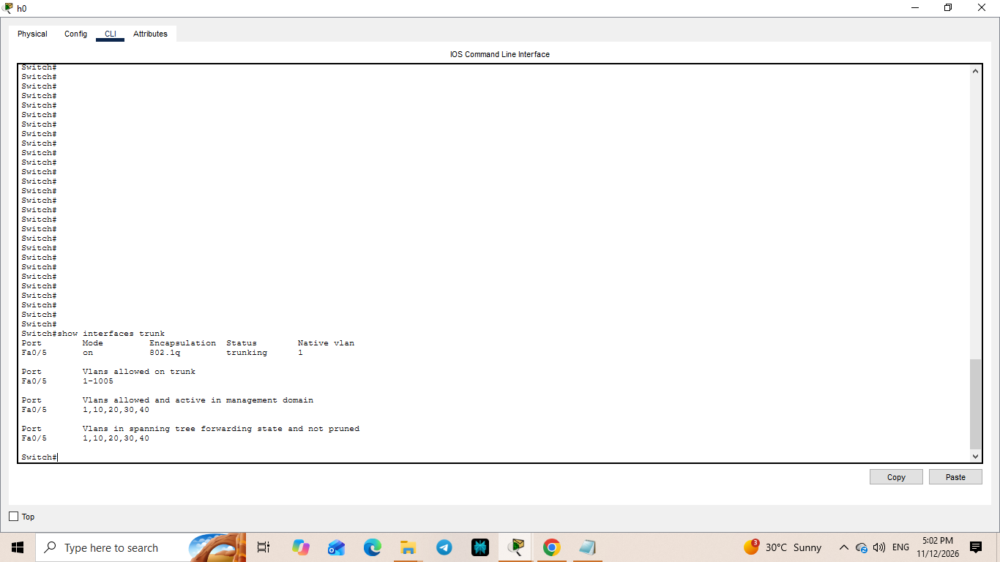
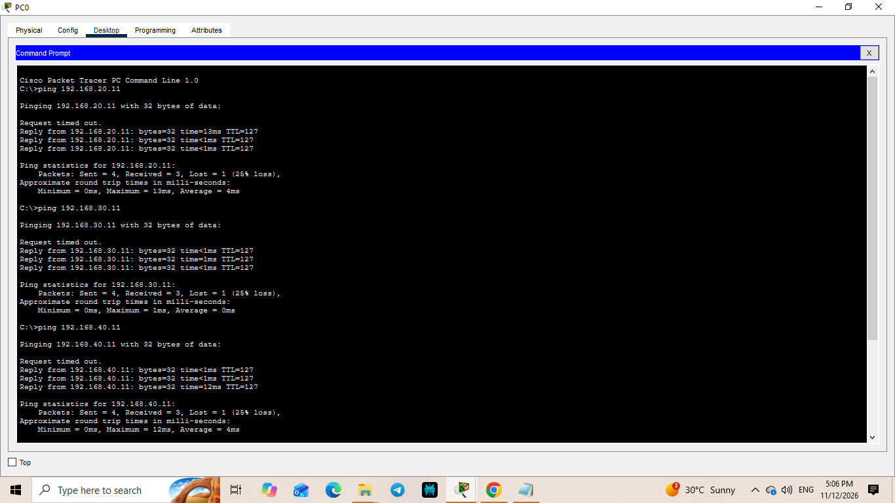

# Small Office Network Design

## 1. Project Overview

This project demonstrates the design, configuration, and testing of a small office network using Cisco Packet Tracer.

The network is divided into four departments using Virtual LANs (VLANs). Router-on-a-Stick is implemented to enable communication between different VLANs.

The router also provides dynamic IP address allocation through DHCP.

**Project Version:** 1.0  
**Platform:** Cisco Packet Tracer  
**Network Type:** Small Office LAN

---

## 2. Technologies and Concepts Used

- Cisco Packet Tracer
- Cisco 2911 Router
- Cisco 2960 Layer 2 Switch
- VLAN Configuration
- Access Ports and Trunk Ports
- IEEE 802.1Q Encapsulation
- Router-on-a-Stick
- Inter-VLAN Routing
- Dynamic Host Configuration Protocol (DHCP)
- IPv4 Addressing
- Network Connectivity Testing

---

## 3. Network Topology

The network consists of one router, one Layer 2 switch, and four PCs representing four different departments.

### Device Details

| Device | Model | Purpose |
|---|---|---|
| Router | Cisco 2911 | Inter-VLAN routing and DHCP |
| Switch | Cisco 2960 | VLAN management and switching |
| PC0 | PC | ADMIN department |
| PC1 | PC | HR department |
| PC2 | PC | IT department |
| PC3 | PC | FINANCE department |

---

## 4. VLAN and IP Addressing Plan

Four VLANs were created to logically separate the departments.

| Department | VLAN ID | Network Address | Default Gateway |
|---|---:|---|---|
| ADMIN | 10 | 192.168.10.0/24 | 192.168.10.1 |
| HR | 20 | 192.168.20.0/24 | 192.168.20.1 |
| IT | 30 | 192.168.30.0/24 | 192.168.30.1 |
| FINANCE | 40 | 192.168.40.0/24 | 192.168.40.1 |

### Switch Port Assignments

| Switch Port | Connected Device | VLAN |
|---|---|---:|
| Fa0/1 | PC0 | 10 |
| Fa0/2 | PC1 | 20 |
| Fa0/3 | PC2 | 30 |
| Fa0/4 | PC3 | 40 |
| Fa0/5 | Router G0/0 | Trunk |

---

## 5. Network Configuration

### 5.1 VLAN Configuration

Four VLANs were created on the Cisco 2960 switch.

- VLAN 10 – ADMIN
- VLAN 20 – HR
- VLAN 30 – IT
- VLAN 40 – FINANCE

Access ports were assigned to their respective VLANs.

### 5.2 Trunk Configuration

The switch interface Fa0/5 was configured as a trunk port to connect the switch with the router.

IEEE 802.1Q encapsulation allows traffic from multiple VLANs to travel through the same physical link.

### 5.3 Router-on-a-Stick

Router-on-a-Stick was implemented using four router subinterfaces on GigabitEthernet0/0.

Each subinterface was configured with:

- An 802.1Q VLAN ID
- An IP address
- A subnet mask

The router acts as the default gateway for all four VLANs.

### 5.4 DHCP Configuration

The Cisco 2911 router was configured as a DHCP server.

Four separate DHCP pools were created:

- ADMIN
- HR
- IT
- FINANCE

The first ten IP addresses in each subnet were excluded from dynamic allocation.

Each DHCP pool provides:
- IP address
- Subnet mask
- Default gateway
- DNS server (8.8.8.8)

---

## 6. Network Testing and Verification

The network was tested to verify correct configuration and communication.

### Verification Commands

| Command | Purpose |
|---|---|
| `show vlan brief` | Verify VLANs and port assignments |
| `show interfaces trunk` | Verify trunk configuration |
| `show ip interface brief` | Check router interfaces |
| `show ip dhcp pool` | Check DHCP pools |
| `show ip dhcp binding` | Verify DHCP address assignments |
| `ping` | Test network connectivity |

### DHCP Verification

All four PCs successfully obtained IP addresses from their respective DHCP pools.

### Inter-VLAN Connectivity

Ping tests were performed between PCs belonging to different VLANs.

Successful replies confirmed inter-VLAN communication through the router.

---

## 7. Project Files

| File | Description |
|---|---|
| `small-office-network-v1.pkt` | Cisco Packet Tracer network project |
| `show_running-config-router.txt` | Router configuration |
| `Switch-config.txt` | Switch configuration |
| `troubleshooting.md` | Network troubleshooting documentation |

---

## 8. Learning Outcomes

Through this project, I gained practical experience in:

- Creating and managing VLANs.
- Assigning switch access ports.
- Configuring trunk links.
- Understanding IEEE 802.1Q encapsulation.
- Implementing Router-on-a-Stick.
- Configuring DHCP pools.
- Understanding inter-VLAN communication.
- Verifying network configurations using Cisco IOS commands.
- Troubleshooting basic network connectivity issues.

---

## 9. Future Improvements

The following features are planned for future versions:

- Adding a second switch.
- Configuring inter-switch trunking.
- Implementing Spanning Tree Protocol (STP).
- Configuring Access Control Lists (ACLs).
- Implementing network redundancy.
- Adding network security and troubleshooting scenarios.

---

## 10. Conclusion

This project represents my practical learning of fundamental networking concepts using Cisco Packet Tracer.

It demonstrates how VLAN segmentation, trunking, DHCP, and inter-VLAN routing can be implemented in a small office network environment.

**Project Status:** Version 1.0 Completed
